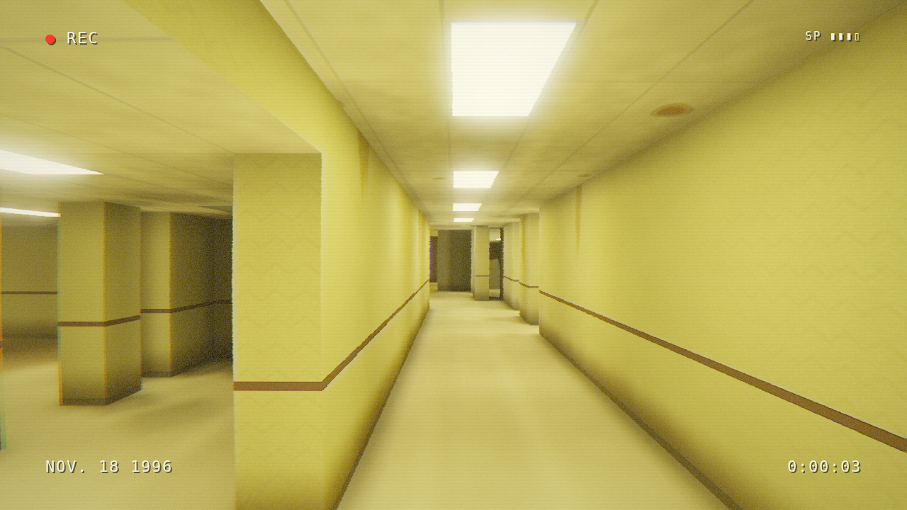

# The Backrooms — procedural Level 0

An infinite, procedurally generated Backrooms you walk through in the browser. Mono-yellow wallpaper,
damp carpet, buzzing fluorescent panels, rooms that make no sense, and office furniture that never
finished loading: sunk into the carpet, pushed into the walls, hanging upside down from the ceiling.
Everything is generated by code. There are no image, model or sound files.



## Run

```bash
npm install
npm run dev        # http://127.0.0.1:5190
npm run build      # static site in dist/
```

Click to enter. Mouse to look, `WASD` to walk, `Shift` to run, `N` noclip, `V` camcorder effects,
`H` camcorder overlay, `Tab` minimap (`[` `]` zoom), `M` full map (click to place marks to reach), `K` sound, `P` stats, `F` fullscreen. `?seed=123` picks a world.

## Multiplayer

Several people can walk the same Backrooms. The world is a pure function of the seed, so the relay
never sends level data: it only gives everyone in a room the same seed and passes player positions
around (about 15 Hz, interpolated 120 ms behind).

```bash
npm run server     # relay on :5191 (the vite dev server proxies /ws to it)
npm run dev        # then open http://127.0.0.1:5190/?room=my-room&name=alice
```

Or type a room and name in the menu and press **JOIN**. Everyone using the same room name meets in
the same world. The first person to join decides the seed (`&seed=123` picks one), and the room
lasts as long as someone is in it. Other players appear as faceless office workers, lit by the same
panels as you, with a name tag and footsteps you can hear through the walls. They also show up as
arrows on the minimap and the full map.

For a single deployment, `npm start` builds the client and serves `dist/` and the relay from one
port (`PORT=8080 npm start`). If the relay can't be reached, the game falls back to single player.

## The Hunt

A horror game mode for 2–16 players in a room. Press **R** in a room to start a round.

- One player is chosen as **the Entity**: a tall, faceless figure. It waits in the dark for 10 s
  while everyone else scatters, then hunts at 3.7 m/s. It can't sprint, but **E** lets it
  **walk through walls** for 2 s (30 s cooldown).
- Everyone else is a **Wanderer**. Sprinting is limited by stamina (about 6 s, then you're out of
  breath until it recovers), and the entity can hear you panting.
- **Caught wanderers become entities.** The hunt snowballs.
- **Wanderers win** if anyone reaches the **exit door**, a lit doorway 70–100 m away shown on the
  wanderers' maps, or if anyone is still free when the 5 minutes are up. **The entity wins** if it
  finds everyone.
- **Warning signs:** lights stutter and die around an entity, the camcorder picture breaks up as one
  closes in, and you hear its drone and heavy steps from where it is. Each side only sees its own
  team on the maps.

The relay is the referee (`shared/hunt.ts`): it picks roles, places the exit and the entity's
spawn, and decides catches (within 1.1 m, with line of sight checked through the same `solid()`
the game renders) and escapes. `npm test` runs the rules; `HUNT_SECONDS=60 npm run server`
shortens rounds for testing.

## Alone, against the Entity

**PLAY ALONE** in the menu (`?solo=easy|normal|nightmare`) runs the hunt in single player. No
relay is needed: the same rules (`shared/hunt.ts`) run in the page, and the Entity is a CPU
(`web/src/ai/`). It doesn't know where you are. It has to find you:

- **Sight:** a 110° cone. Range is shorter in dead zones (24 m lit / 7 m dark on Normal), so the
  dark is where you hide. Walls block it, and a detection meter takes a moment to fill, so a
  glimpse at the edge of its vision isn't fatal.
- **Hearing:** sprinting carries 18 m, walking 5 m, panting 10 m, and walls muffle all of it.
  A noise only tells it roughly where to look.
- **Behaviour:** roam → investigate → chase → search, a small state machine. After losing you it
  heads to where you'd be if you kept going, then checks around there.
- **Phasing:** walls get a finite cost in its pathfinding (A* on the 0.5 m grid) when the ability
  is ready. When cutting through a wall saves a long detour, it simply goes through.
- **A director paces the tension:** if it hasn't found you in a while, it gets a vague hint about
  where you're *heading*, 10–16 m off. Far away and out of your sight, it moves fast (it's never
  seen doing that). After a long chase it backs off for 20–40 s.

The exit is 130–170 m away in single player. `npm run sim` plays the CPU against a scripted
wanderer that walks to the exit and sprints when it sees the Entity coming. Current balance over
30 rounds each: Easy catches it 10% of the time, Normal 33%, Nightmare 87%. A real player can
also hide, so treat these as a relative scale.

## Repository layout

| Folder | What |
|---|---|
| `shared/` | The world generator (`gen.ts`) and the hunt rules (`hunt.ts`). Used by the web client, the relay and the tests. |
| `web/` | The browser client: `web/src/` (three.js), `web/index.html`, `web/vite.config.ts`, and the Playwright scripts in `web/scripts/`. Builds to the root `dist/`. |
| `server/` | The multiplayer relay and hunt referee. Serves `dist/` too. |
| `godot/` | The desktop client: `Core/` (generation, rules, AI, protocol, sound synthesis in C#, no Godot dependency), `Core.Tests/`, and the Godot project in `Game/`. |
| `tests/` | Node tests for the rules and the CPU entity (`npm test`, `npm run sim`), and the generator's golden fixtures (`tests/fixtures/`). |
| `scripts/` | Builds `docs/layout-algorithm.html` from `shared/gen.ts` (`npm run doc`). |
| `docs/` | Explainers and plans, including the [Godot port plan](docs/godot-port-plan.html). |

The npm scripts need Node 22.6 or newer, because the server and tests run `.ts` files directly.

### The desktop client (Godot)

The same game as an installable desktop app (Godot 4.7, C#), in `godot/`. It has the same world,
the same look, the same rooms and hunts (web and desktop players meet through the same relay),
solo play against the CPU entity, the maps and marks. The sound is a temporary version for now.

**Play:** unzip a release build (`backrooms-<version>-linux.zip` / `-windows.zip`) and run
`backrooms.x86_64` / `Backrooms.exe`. Click the menu to go in; the keys are the ones above.
To join a room, type it in the menu, or start with
`Backrooms.exe -- --room=my-room --name=alice --server=ws://your-host:5191/ws`
(the server URL is remembered; the default is `ws://127.0.0.1:5191/ws`). `--solo=normal` plays
alone, `--seed=123` picks a world.

**Develop:** open `godot/Game/project.godot` with the Godot 4.7 .NET editor, or run
`godot --path godot/Game -- --seed=123`. World generation, rules, AI and the rest of the logic are
in `godot/Core` (plain C#, no Godot), tested with `dotnet test`:

```bash
npm run godot:test     # C# tests: generator and chunk parity with the web, rules, AI, map, sound
npm run gen:fixtures   # after changing shared/gen.ts or web/src/chunk.ts: rewrite the golden fixtures
npm run godot:sim      # AI balance simulation (compare with npm run sim)
GODOT=/path/to/godot npm run godot:export   # release builds into godot/build/ (needs export templates)
```

The desktop client must generate exactly the same world as `shared/gen.ts` (the relay decides
catches with it), which the parity tests check against fixtures dumped from the TypeScript.
Pushing a `v*` tag builds both desktop zips in CI (`.github/workflows/ci.yml`).

## How it works

Stack: three.js on WebGL2, hand-written GLSL, Web Audio, Vite + TypeScript (the same approach as
Synthwave City), plus Playwright for screenshots.

| Piece | File | Notes |
|---|---|---|
| Layout | `shared/gen.ts` | A pure function of `(seed, cell)`, with 0.5 m cells. Warped zones (office, maze, corridor, pillar hall, weird, void) each have their own wall spacing, door odds, ceiling height and chair rail. Chunks can be built in any order and their edges always match. |
| Chunks | `web/src/chunk.ts` | Chunks are 32 m. Each one is a single floor quad, greedy-merged ceilings and walls (soffits where ceiling heights change), a 96×96 occupancy/height texture with a 16-cell border, and a 16×16 light-state texture. That makes 2 draw calls per chunk, about 30 draw calls and about 30k triangles per frame. Chunks are streamed around the player within a time budget. |
| Lighting | `web/src/shaders.ts` | Lighting is computed per pixel from the 4×4 nearest ceiling panels. Soft wall shadows are ray-marched through the occupancy texture, and ambient occlusion is read from the same texture. Some panels are dead, some flicker, and there are dark blocks. No shadow maps, no lightmaps. |
| Materials | `web/src/shaders.ts` | Procedural wallpaper (column lines, chevrons, seams, grime, water stains), carpet, 2×4 ft acoustic tiles and prismatic light panels. Fine detail fades out based on how much of the surface each pixel covers, so it doesn't shimmer (moiré). |
| Props | `web/src/props.ts` | Furniture is built from boxes. A prop can be half-rendered (wireframe above a moving "streaming" edge, plain untextured grey below it), merged into the surface it touches (its colour turns into carpet, wallpaper or ceiling tile), or covered in wallpaper. Also: doors leading nowhere and stairs into the ceiling. |
| Post | `web/src/post.ts` | HDR + MSAA, two-level bloom, ACES tone mapping, yellow/olive grade, composite-video chroma bleed, chromatic aberration, tape jitter, grain, vignette. Resolution scales automatically to keep the frame time under about 18 ms. |
| CPU entity | `web/src/ai/path.ts`, `web/src/ai/entity.ts`, `web/src/localnet.ts` | A* with phase-aware wall costs and string-pulling; senses, state machine and director; an in-page stand-in for the relay. |
| The Hunt | `shared/hunt.ts`, `web/src/hunt.ts` | Server-side round state machine and referee; client stamina, phasing, HUD, light-killing entities (shader uniform), dread grade, positional drone/breathing. |
| Multiplayer | `server/server.ts`, `web/src/net.ts`, `web/src/avatars.ts` | WebSocket relay with rooms (max 16), one pose batch per room per tick, snapshot interpolation on the client. Avatars are lit with the prop shader and the textures of the chunk they stand in. |
| Sound | `web/src/audio.ts` | Hum from the mains and the ballasts. The nearest panels buzz as HRTF-positioned sources, and the flickering ones crackle. Random events through a synthetic reverb: footsteps that aren't yours, knocking inside walls, distant slams, drones, creaks, and breathing behind you. |

## Screenshots

```bash
npm run dev &
node web/scripts/shot.mjs --out shots/x --views 0,1,2          # auto viewpoints with long sight lines
node web/scripts/shot.mjs --out shots/x --views "prop=3&pname=door"
node web/scripts/sheet.mjs shots/x/sheet.png shots/x/*.png     # contact sheet
node web/scripts/smoke.mjs                                      # interactive run, errors + stats
node web/scripts/mptest.mjs                                     # two players in one room (needs npm run server)
node web/scripts/hunttest.mjs                                   # a full hunt round with two players
node web/scripts/solotest.mjs                                   # single player vs the CPU, end to end
```
